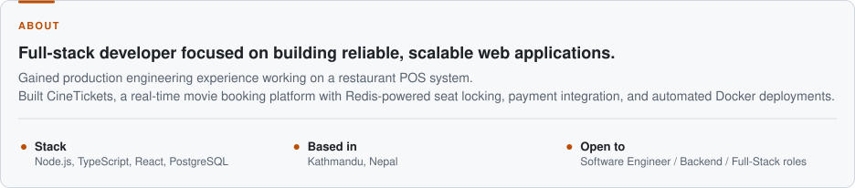
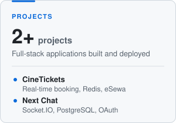
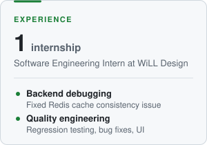
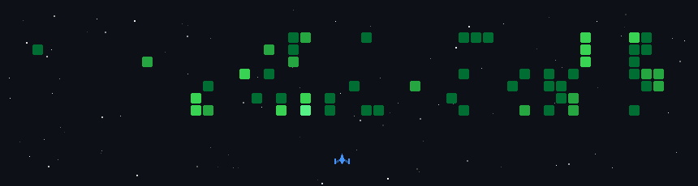

<h1>Karun Ghimire</h1>

<b>Full-stack developer</b>

 

<a href="https://www.ghimirekarun.com.np/"><picture><source media="(prefers-color-scheme: dark)" srcset="assets/card-about-dark.svg" /></picture></a>

<a href="https://multiply-oversized-ceramics.ngrok-free.dev/"><picture><source media="(prefers-color-scheme: dark)" srcset="assets/card-projects-dark.svg" /></picture></a>
<a href="#"><picture><source media="(prefers-color-scheme: dark)" srcset="assets/card-experience-dark.svg" /></picture></a>
<a href="#"><picture><source media="(prefers-color-scheme: dark)" srcset="assets/card-infrastructure-dark.svg" /></picture></a>

 

<h2 align="center">Tech stack</h2>

<h4 align="center">Languages</h4>

<h4 align="center">Frontend &amp; Mobile</h4>

<h4 align="center">Backend &amp; Databases</h4>

<h4 align="center">Cloud &amp; DevOps</h4>

<h4 align="center">Tools</h4>

 

<h2 align="center">GitHub Activity</h2>

  <picture>
    <source
      media="(prefers-color-scheme: dark)"
      srcset="https://github-stats-extended.vercel.app/api?username=KarunJr&hide_title=true&show_icons=true&include_all_commits=true&theme=blue_navy"
    />
    
  </picture>
  <picture>
    <source
      media="(prefers-color-scheme: dark)"
      srcset="https://github-stats-extended.vercel.app/api/top-langs?username=KarunJr&layout=compact&langs_count=4&theme=dark_github"
    />
    
  </picture>

  

  <picture>
    <source
      media="(prefers-color-scheme: dark)"
      srcset="https://raw.githubusercontent.com/KarunJr/KarunJr/output/snake-dark.svg"
    />
    
  </picture>

